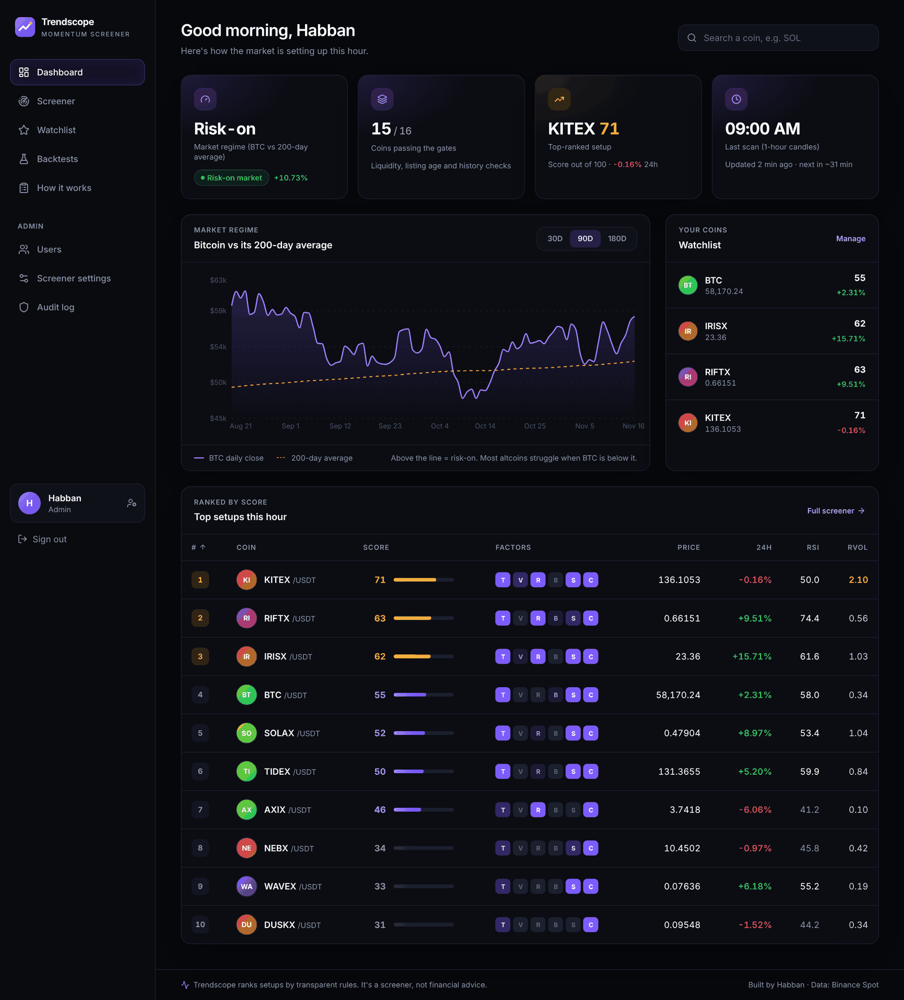
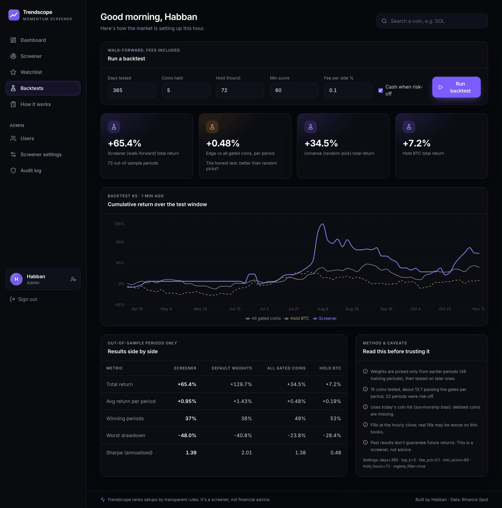
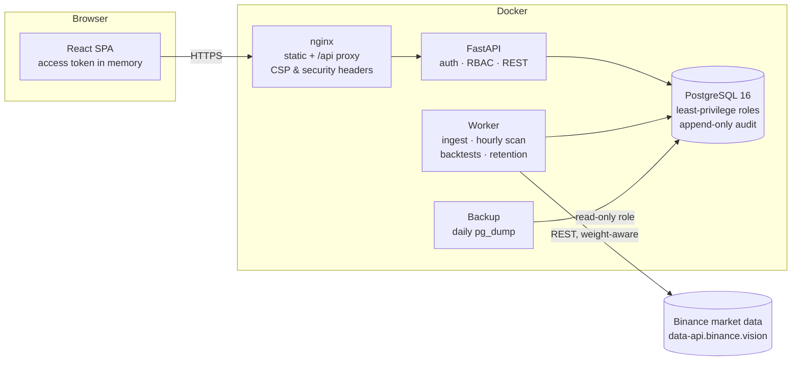
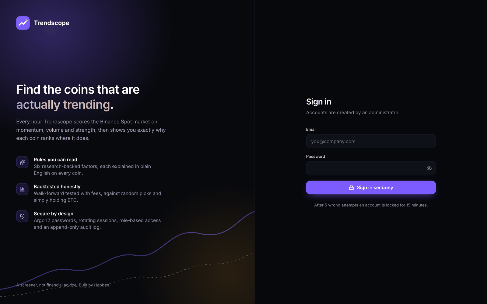
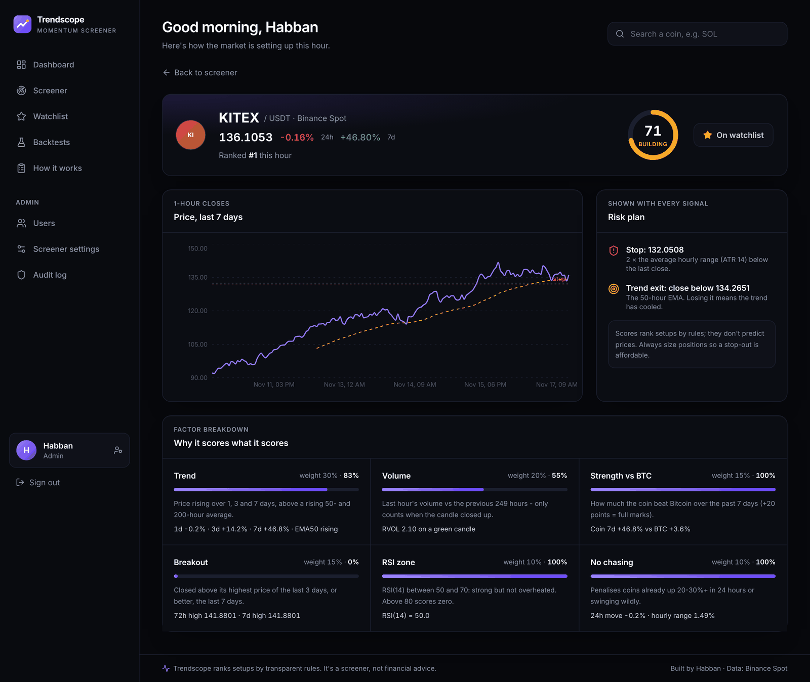
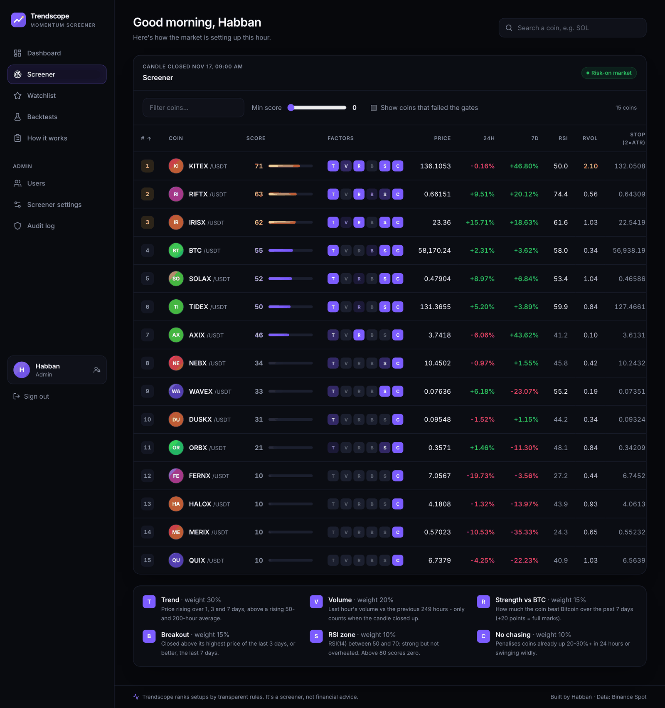
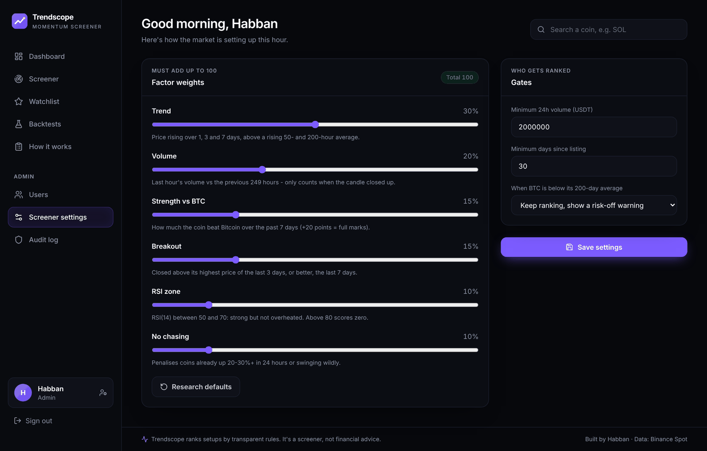
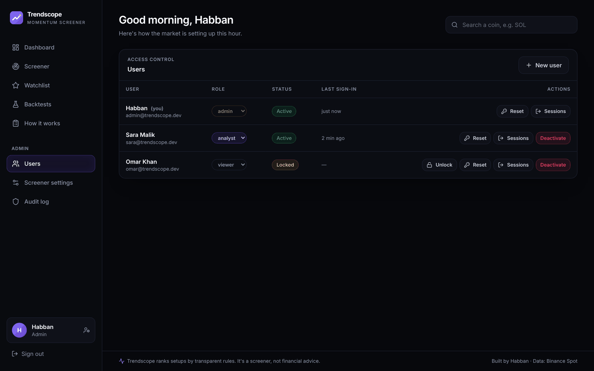
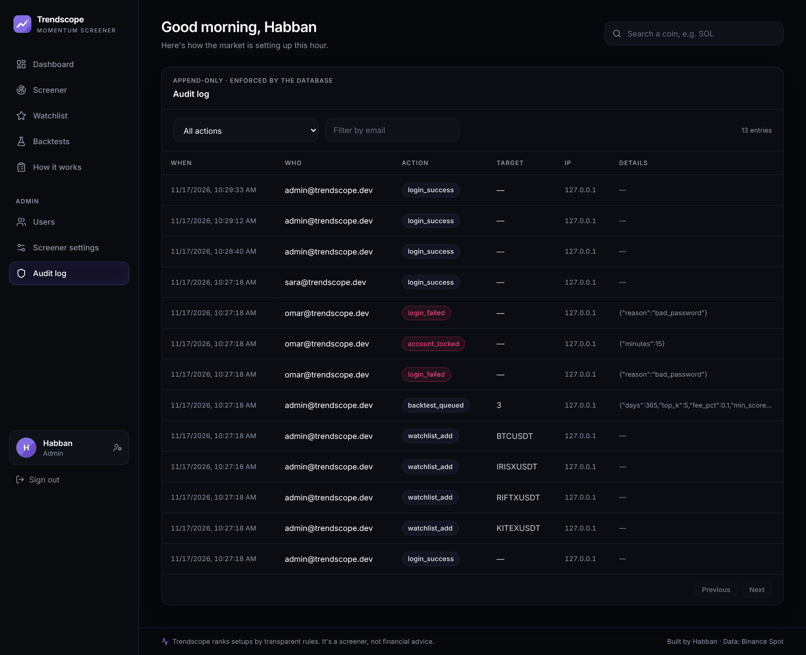

<div align="center">


# Trendscope

**A transparent, backtested crypto momentum screener for Binance Spot.**
Every hour it scores the market on six research-backed rules, ranks the coins, and shows exactly *why* each one ranks where it does, together with a risk plan.

[](https://github.com/iamhabban-blip/crypto-momentum-screener/actions/workflows/ci.yml)




<sub>Screenshots use the built-in demo market (fictional coins ending in "X"), so they never show misleading real prices.</sub>

</div>

---

## What it does

* **Screens** every Binance Spot USDT pair with real liquidity (2M+ USDT a day by default), every hour, from closed candles only.
* **Scores** each coin 0-100 on six factors and ranks them, highest first.
* **Explains** every score in plain English: which factor contributed what, with the raw numbers.
* **Attaches a risk plan** to every signal: a 2×ATR stop and a trend-exit level.
* **Checks the market regime**: when Bitcoin is below its 200-day average, signals are flagged or suppressed.
* **Backtests itself** honestly: walk-forward, fees included, compared with random picks and simply holding BTC.
* **Runs like a real product**: accounts and roles, rotating sessions, an append-only audit log, admin-tunable weights, automatic backups.

> Trendscope is a **screener**: it ranks setups by transparent rules. It does not predict prices and is not financial advice.

## The rules

### 1. Gates: who gets ranked at all
| Gate | Default | Why |
|---|---|---|
| 24h volume | ≥ 2,000,000 USDT | thin markets are easy to push around |
| Listing age | ≥ 30 days of history | new listings behave erratically |
| Market regime | BTC above its 200-day average = risk-on | most altcoins fall with BTC |

### 2. Score: six factors
| Factor | Rule | Weight |
|---|---|---|
| **Trend** | positive 1-, 3- and 7-day returns; price above a rising 50 EMA and the 200 EMA | 30 |
| **Volume** | RVOL vs the previous 249 hours, **only on an up candle** | 20 |
| **Strength vs BTC** | 7-day return minus BTC's (+20 pts = full marks) | 15 |
| **Breakout** | close above the 72h / 7-day high | 15 |
| **RSI zone** | RSI(14) 50-70 ideal; overheated >80 scores 0 | 10 |
| **No chasing** | penalises 20-30%+ pumps in 24h and extreme volatility | 10 |

RSI and ATR use Wilder's smoothing exactly as TradingView and Binance charts do (unit-tested against a reference implementation). Weights are editable by admins and every change is audit-logged.

### 3. Why these factors
* Liu, Tsyvinski & Wu, *Common Risk Factors in Cryptocurrency*, Journal of Finance (2022): market, size and **momentum** capture most expected crypto returns.
* Han, Kang & Ryu, *Time-Series and Cross-Sectional Momentum in the Cryptocurrency Market*: under realistic assumptions **time-series momentum is strong** and cross-sectional momentum is weak, which is why Trend carries the most weight.
* Bianchi & Dickerson, *Trading Volume in Cryptocurrency Markets*: **abnormal volume combined with past returns** predicts returns, which is why volume only counts on up candles.

## Backtesting: built to be hard to fool



* **Walk-forward:** several weight sets compete, but each period uses the set that did best on *earlier* periods only. The first 40% of the window is training and never reported.
* **Fees** are charged on entry and exit (0.1% per side by default).
* **Two baselines:** an equal-weight basket of every coin that passed the gates ("what random picks get you") and buy-and-hold BTC. The headline number is the **edge over random picks**, not the raw return.
* **Caveats are printed with every result**, including survivorship bias (today's coin list) and fills at the hourly close.

Run one from the **Backtests** page (analyst or admin role). The worker downloads up to 3 years of hourly candles and stores the result.

## Architecture



* **One scoring engine** (`backend/engine/scoring.py`), vectorised over the whole history, is used by both the live scanner (last row) and the backtest (every row), so the two can never disagree.
* The worker stores **closed candles only**, never looks at the PC clock to decide what's closed, and **repairs gaps** after downtime by reloading history.
* It reads Binance's own `x-mbx-used-weight` header and slows down long before the rate limit, so the app never gets banned.

## Security & data management

| | |
|---|---|
| Passwords | Argon2id, 12+ chars, common passwords blocked |
| Sessions | 15-min JWT in memory + rotating httpOnly refresh cookie; **replayed tokens revoke the whole session family** |
| Brute force | per-IP rate limit + account lockout after 5 failures |
| Access | viewer / analyst / admin roles; no self-registration; the last admin can't be removed |
| Revocation | deactivating a user or changing a password kills their sessions instantly |
| Database | separate owner / app / read-only roles; app role can't run DDL or edit the audit log |
| Audit | every login, lockout, role change and settings change, written in the same transaction; append-only via trigger |
| Retention & backups | automatic pruning + daily compressed backups with 7-day rotation |

Details: [docs/SECURITY.md](docs/SECURITY.md) · [docs/DATABASE.md](docs/DATABASE.md)

## Quick start

Requires Docker with Compose v2.

```bash
git clone https://github.com/iamhabban-blip/crypto-momentum-screener.git
cd crypto-momentum-screener
./scripts/init-env.sh          # creates .env with random secrets and prints the first admin login
docker compose up -d --build   # db, migrations, API, worker, web, backups
```

Open **http://localhost:8080** and sign in. The first scan appears within a few minutes while the worker loads history.

**Offline demo** (no Binance access needed; fictional market):

```bash
BINANCE_BASE_URL=http://simulator:9100 docker compose --profile demo up -d --build
```

Market data comes from `data-api.binance.vision`, Binance's public market-data endpoint, which also works in regions where binance.com is restricted.

## Local development

```bash
# backend (needs a local Postgres with the roles from backend/sql/00_roles.sql)
cd backend && pip install -r requirements-dev.txt
alembic upgrade head
uvicorn app.main:app --reload             # API on :8000, docs at /api/docs
python -m engine.simulator --port 9100    # optional: fake market
BINANCE_BASE_URL=http://localhost:9100 python -m engine.worker

# frontend
cd frontend && npm install && npm run dev  # http://localhost:5173 (proxies /api)

# tests
cd backend && pytest
```

## Screens

| | |
|---|---|
|  |  |
| **Sign in:** admin-created accounts, lockout notice | **Coin detail:** score, factor breakdown, risk plan |
|  |  |
| **Screener:** sortable, filterable, factor chips | **Settings:** weights must total 100, audit-logged |
|  |  |
| **Users:** roles, unlock, reset, end sessions | **Audit log:** append-only, filterable |

## Project layout

```
backend/
  app/            FastAPI app: config, models, auth, routers
  engine/         scoring rules, indicators, Binance client, worker, backtest, simulator
  alembic/        migrations (incl. audit-log trigger and permissions)
  sql/            database roles
  tests/          auth, scoring, worker end-to-end, backtest
frontend/         React + TypeScript + Tailwind, served by nginx
scripts/          env generator, DB init, backups
docs/             security, database, screenshots
```

## License

MIT © Muhammad Habban. Built as a portfolio project; not affiliated with Binance.
