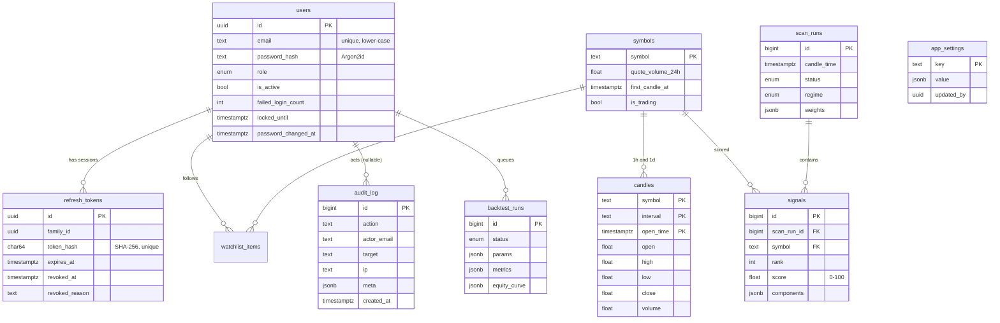

# Database design & management rules

PostgreSQL 16. All schema changes go through Alembic migrations (`backend/alembic/versions`).

## Schema



## Roles: least privilege

| Role | Used by | Can | Cannot |
|---|---|---|---|
| `postgres` | first-boot init only | everything | never used by the app |
| `trendscope_owner` | `migrate` container only | own the schema, run DDL | is not used at runtime |
| `trendscope_app` | API + worker | `SELECT/INSERT/UPDATE/DELETE` on data tables | create/alter/drop tables; `UPDATE`/`DELETE`/`TRUNCATE` the audit log |
| `trendscope_readonly` | backup container | `SELECT` only (session forced read-only) | write anything |

Defined in [`backend/sql/00_roles.sql`](../backend/sql/00_roles.sql) and [`scripts/init-db.sh`](../scripts/init-db.sh); passwords are generated per install by `scripts/init-env.sh` and never committed. The database port is **not published** outside the Docker network.

## Management rules

| # | Rule | Enforced by |
|---|---|---|
| 1 | **Audit log is append-only.** `UPDATE` always fails; `DELETE` only works for the owner role inside an explicit purge transaction. | trigger `audit_log_append_only` + revoked privileges |
| 2 | Every security-relevant action (logins, lockouts, role changes, settings changes, token theft) is audited in the **same transaction** as the change. | `deps.audit()` |
| 3 | Emails are unique case-insensitively and stored lower-case. | unique index on `lower(email)` + check constraint |
| 4 | Passwords are stored only as Argon2id hashes; refresh tokens only as SHA-256 hashes. A database leak exposes neither. | `security.py` |
| 5 | Market data is validated twice: rows with `high < low`, negative volume etc. are dropped by the worker, and check constraints reject anything that slips through. | `valid_candle()` + `ck_candles_*` |
| 6 | Signal scores must lie within 0-100; one signal per coin per scan. | `ck_signals_score_range`, `uq_signals_run_symbol` |
| 7 | No query may run longer than 15 s; idle-in-transaction sessions are killed after 60 s; the app role is capped at 40 connections. | role settings |
| 8 | There is always at least one active admin, and admins can't demote themselves. | API rule (`routers/admin.py`) |
| 9 | Deleting a user cascades to their sessions and watchlist, but keeps their audit history (`user_id` set to NULL, email kept). | foreign keys |
| 10 | Only one worker can write market data at a time. | Postgres advisory lock |

## Data retention

Applied daily by the worker:

| Data | Kept for |
|---|---|
| 1h / 1d candles | 800 days |
| Scan runs + signals | 90 days |
| Expired / revoked sessions | 30 days after expiry |
| Audit log | indefinitely by default (purge manually, see below) |

Purging old audit entries (owner role, deliberate act):

```sql
BEGIN;
SET LOCAL trendscope.audit_purge = 'on';
DELETE FROM audit_log WHERE created_at < now() - interval '365 days';
COMMIT;
```

## Backups

The `backup` service runs `pg_dump` as the read-only role every 24 hours, writes `backups/trendscope-YYYYmmdd-HHMM.sql.gz` atomically (`.part` file renamed on success) and keeps 7 days (`BACKUP_KEEP_DAYS`).

Restore into a fresh database:

```bash
docker compose stop api worker
gunzip -c backups/trendscope-20261117-0400.sql.gz | docker compose exec -T db psql -U postgres -d trendscope
docker compose start api worker
```

## Migrations

* `docker compose up` runs `alembic upgrade head` once in the `migrate` container (owner role) before the API and worker start.
* New migration: `cd backend && alembic revision --autogenerate -m "describe change"`, review the file, commit it.
* Migrations must be reversible (`downgrade()` implemented) and must never be edited after release.
