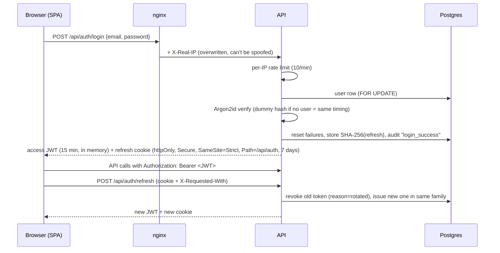

# Security model

## Authentication

| Control | Detail |
|---|---|
| Password hashing | Argon2id (argon2-cffi defaults), automatic re-hash when parameters are raised |
| Password policy | 12-128 characters, blocks common passwords and passwords containing the email name (NIST 800-63B style: length over complexity rules) |
| Brute force | 10 login attempts per IP per minute; account locked 15 min after 5 failures (admins can unlock) |
| Account enumeration | identical error and timing for unknown email vs wrong password |
| Access token | HS256 JWT, 15 min, checks `iss`, `aud`, `exp`; kept in memory only (not localStorage) |
| Refresh token | 384-bit random, stored hashed, rotated on every use |
| Token theft detection | replaying a rotated token revokes the whole login family and is audited (`refresh_token_reuse_detected`) |
| Instant revocation | password change, admin reset, deactivation or role change invalidates every live access token (`password_changed_at` vs `iat`) and every refresh token |
| CSRF | refresh cookie is `SameSite=Strict` and path-scoped; cookie endpoints also require the `X-Requested-With` header |
| Two tabs refreshing at once | 15 s grace window returns `409 retry` instead of treating it as theft |

## Authorization (RBAC)

| Capability | viewer | analyst | admin |
|---|:-:|:-:|:-:|
| View screener, coins, BTC regime, backtest results | ✓ | ✓ | ✓ |
| Own watchlist | ✓ | ✓ | ✓ |
| Queue backtests | | ✓ | ✓ |
| Manage users (create, role, deactivate, unlock, reset, end sessions) | | | ✓ |
| Change screener settings (weights, filters) | | | ✓ |
| Read the audit log | | | ✓ |

There is no self-registration: accounts are created by an admin. The first admin comes from `BOOTSTRAP_ADMIN_*` and is created only if no admin exists.

## Transport & browser hardening

* One origin: nginx serves the SPA and proxies `/api`, so no CORS is needed in production.
* Headers: `Content-Security-Policy` (self only, no inline scripts), `X-Frame-Options: DENY`, `X-Content-Type-Options: nosniff`, `Referrer-Policy: no-referrer`, `Permissions-Policy`, `Cache-Control: no-store` on API responses.
* Containers run as a non-root user; the database is not exposed to the host.
* Set `COOKIE_SECURE=true` and terminate TLS (e.g. Caddy, Traefik or a cloud load balancer) before exposing the app publicly.

## Audit events

`login_success`, `login_failed`, `login_blocked_locked`, `account_locked`, `logout`, `logout_all_sessions`, `refresh_token_reuse_detected`, `password_changed`, `password_change_failed`, `password_reset_by_admin`, `sessions_revoked_by_admin`, `user_created`, `user_updated`, `user_unlocked`, `settings_changed` (with before/after), `backtest_queued`, `watchlist_add`, `watchlist_remove`.

## Secrets

* `scripts/init-env.sh` generates unique random database passwords and a 64-character JWT secret per install. `.env` is git-ignored and `chmod 600`.
* The API refuses to start with a placeholder or short (<32 char) `JWT_SECRET`.

## What's tested

`backend/tests/test_auth.py` covers cookie flags, identical failure responses, lockout, per-IP rate limiting, refresh rotation and reuse detection, logout, token invalidation after password change and deactivation, weak-password rejection, role enforcement, the last-admin rule, settings validation with audit, and security headers.
